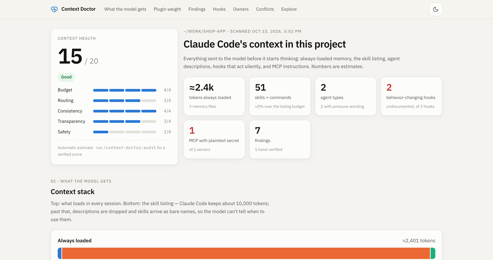

# Context Doctor

[](../../actions/workflows/ci.yml)

See, score and fix what feeds Claude Code's context.

Claude Code's context is assembled from many places you rarely see together: the CLAUDE.md chain and its `@imports`, auto-memory, hundreds of skill and agent descriptions from plugins, hooks that rewrite commands or inject text, and instructions from MCP servers. When they pile up, skills lose their descriptions, rules contradict each other, and the model starts doing things nobody asked for. Context Doctor makes that visible and helps you clean it up.



## What you get

**Skills** — the model does the judgment; a bundled scanner supplies the facts.

| Command | What it does |
|---|---|
| `/context-doctor:view` | Open the dashboard: health score, context stack, plugin weight vs real usage, findings, hooks across the session lifecycle, competing owners, rule conflicts, searchable explorer. Changes nothing. |
| `/context-doctor:audit` | Scored health check (budget, routing, consistency, transparency, safety — 0–4 each, /20), P0–P3 findings verified at file:line, and what to run next. |
| `/context-doctor:distill` | Cut weight: disable plugins and skills your transcripts show you never use, shrink always-loaded memory. |
| `/context-doctor:sharpen` | Fix routing: one owner per job, specific "Use when" descriptions, no PROACTIVELY / MUST BE USED pressure. |
| `/context-doctor:harmonize` | Resolve contradictions and stale facts between CLAUDE.md, memory, skills and MCP instructions. |
| `/context-doctor:annotate` | Document hooks that rewrite, compress, inject, format or deny, so the model knows about them. |
| `/context-doctor:secure` | Plaintext secrets, auto deploy/push wording, risky hooks, untrusted third-party instructions. |
| `/context-doctor:trace <behavior>` | Find which line, skill, hook or MCP instruction caused a specific behavior. |

Every command that changes files shows a change table and asks first, backs files up, and never edits the plugin cache (it disables instead).

**Side pane** (terminal; needs a Claude Code build with plugin function hooks): `/context-doctor`, `/context-doctor-prompt` (the real system prompt sections, with sizes), `/context-doctor-live` (skills, agents, MCP calls and hook injections as they happen), `/context-doctor-usage`, `/context-doctor-diff`, `/context-doctor-plugins` (toggle plugins per project). The skills work without the pane.

## Install

From GitHub (replace `OWNER` with the account that hosts this repository):

```
/plugin marketplace add OWNER/context-doctor
/plugin install context-doctor@context-doctor
/reload-plugins
```

From a local clone: `git clone <repo-url> ~/context-doctor`, then `/plugin marketplace add ~/context-doctor` and the same two commands.

Then run `/context-doctor:view`, followed by `/context-doctor:audit`.

Requirements: Node.js 18+ on PATH. The pane uses a POSIX shell (macOS/Linux).

## Privacy

Everything runs locally. The scanner reads your Claude Code config (`~/.claude`, `~/.claude.json`, the project's `.claude/` and CLAUDE.md files) and, for usage stats, your local transcripts under `~/.claude/projects/` (counted, never followed or copied). It writes only to `~/.claude/context-doctor/`, with two exceptions you trigger yourself: `--set-plugin` writes the project's `.claude/settings.local.json` (personal and gitignored — never the checked-in `.claude/settings.json`, so a toggle never reaches your team), and `--dismiss` writes `dismissed.json`. Nothing is sent anywhere; the dashboard makes no network requests.

Reports contain file paths, MCP hosts and the **names** of keys that look like secrets. Values are redacted everywhere — MCP env/headers/args, hook commands (`Authorization: Bearer «redacted»`), settings `env`, and credential-looking lines in memory (reported as file:line only). Redaction is pattern-based, so still check `report.html` before you share it.

## Scanner

The skills call `scanner/scan.mjs` (no dependencies). You can run it yourself:

```
node scanner/scan.mjs --summary            # findings in the terminal; writes report.json + report.html
node scanner/scan.mjs --usage              # real usage from transcripts (--all-projects for everything)
node scanner/scan.mjs --diff               # changes since the last scan
node scanner/scan.mjs --find "deploy|push" # every rule, description and hook mentioning it, with file:line
node scanner/scan.mjs --plugins            # per-plugin counts as JSON
node scanner/scan.mjs --set-plugin <id> off # writes .claude/settings.local.json
node scanner/scan.mjs --dismiss "<subject>::<source>"  # hide a conflict candidate you ruled out
node scanner/scan.mjs --print-dir          # this project's state folder
```

`--usage` combines two local sources: transcripts (what was used in the window — skills, agents, typed commands, MCP calls, hook run time and timeouts, denied tool calls) and Claude Code's own lifetime counters in `~/.claude.json` (`skillUsage`, `pluginUsage`). Plugins that only ship a theme, output style or monitor have no usage signal at all; the table says so instead of calling them unused.

Options: `--project <dir>` (default: current directory), `--out <dir>` (default `~/.claude/context-doctor`), `--lang en|th` (default: from `settings.language`).

### Tuning

`~/.claude/context-doctor/` holds `report.json`/`report.html` (latest scan) and `projects/<project>/` (each project's own report, `usage.json` and `audit.json`, so scanning one project never overwrites another). You may add:

- `config.json` — `{ "lang": "en", "contextWindow": 1000000, "listingBudget": 10000, "thaiTokensPerChar": 1.44, "otherCharsPerToken": 2.46 }`. The skill-listing budget is ≈1% of the context window; the scanner reads the window from your `model` setting (`[1m]` → 1M) and otherwise assumes 200k. Set `contextWindow` (or `listingBudget` directly) if `/context` shows otherwise. Token counts are estimates calibrated against `/context`.
- `curated.json` — your own hand-verified checks, same shape as `scanner/rules.json`; shown while their `requires` condition holds.
- `dismissed.json` — `["<subject>::<source>", …]` rule-conflict candidates you ruled out (written by `--dismiss` and `/context-doctor:harmonize`).
- `system-prompt.md` — saved by the side pane at session start; it is how MCP and claude.ai connector instructions (not on disk) get into the scan.

## How it scores

Anti-patterns CL-01…CL-18 are catalogued in [skills/context-doctor/reference/anti-patterns.md](skills/context-doctor/reference/anti-patterns.md). The automatic score is a rough estimate from scanner signals; `/context-doctor:audit` reads each source and gives the score you should trust. Rule-conflict detection is keyword-based and flags candidates for a human, not verdicts.

Harness rules (from Claude Code's own system prompt) are not on disk; the scanner carries a short paraphrase of the ones that matter for conflicts, and the skills read the live prompt.

**Context Doctor and `/doctor`.** Claude Code's built-in `/doctor` checks the installation — duplicate installs, version, settings files that fail to parse, permission mode and allow rules. Context Doctor checks what the model reads — memory, the skill listing, routing, contradictions, hidden hooks, secrets in context. `/context-doctor:audit` hands installation and permission issues to `/doctor` rather than scoring them.

## Development

```
node --test scanner/test/scan.test.mjs   # scanner tests on a synthetic ~/.claude
claude plugin test .                     # pane tests
claude plugin validate .
node scanner/test/demo.mjs               # renders docs/demo-out/report.html from the fixture
```

## ภาษาไทย

Context Doctor แสดงให้เห็นว่ามีอะไรถูกป้อนเข้า context ของ Claude Code บ้าง ได้แก่ CLAUDE.md, memory, skill/agent จาก plugin, hook ที่ทำงานเงียบ ๆ และคำสั่งจาก MCP ให้คะแนน ชี้ข้อขัดแย้ง และช่วยแก้ ทุกอย่างทำงานในเครื่อง ไม่ส่งข้อมูลออกไปไหน

เริ่มด้วย `/context-doctor:view` แล้วตามด้วย `/context-doctor:audit` ภาษาของรายงานจะตาม `settings.language` (ถ้าตั้งเป็นไทย รายงานจะเป็นภาษาไทย) หรือกำหนดเองด้วย `--lang th`

## License

MIT
